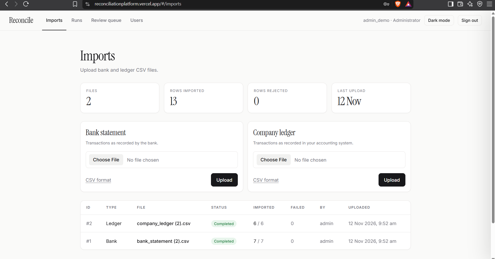

# Reconciliation Platform

[](https://github.com/Droughtt/Reconciliation-Platform/actions/workflows/ci.yml)

A web application that helps finance teams compare a bank statement with a company ledger, find discrepancies, and record how each one was investigated. Upload two CSV files, let the matching engine pair the transactions, then review everything that did not match cleanly. Every review decision is kept in an audit trail, and the whole run can be exported as a CSV report.

One rule shaped the design: **an anomaly is a reason to investigate, not a verdict.** Nothing in the app is labelled "fraud". Unusual transactions are flagged as *needs review*, and a human records what they found and why.

**Live demo:** https://reconciliationplatform.vercel.app/
The demo runs on free hosting, so the first request after a quiet period is slow (see [Known limitations](#known-limitations)).

| Demo user | Role | Password |
|---|---|---|
| `admin_demo` | Administrator | `ReconDemo2026` |
| `analyst_demo` | Analyst | `ReconDemo2026` |
| `reviewer_demo` | Reviewer | `ReconDemo2026` |

These are demo accounts with synthetic data only.

## Screenshots
### Users (administrators)



| Imports | Run results |
|---|---|
|  |  |
| **Review queue** | **Users (administrators)** |
|  |  |

## What it does

- **Reliable imports.** Upload bank and ledger CSV files. Each row is validated on its own. Bad rows never stop the import: they are saved with the line number, the original values and a plain-English reason, and shown in a "Rows that need fixing" drawer. Uploading the same file twice is rejected using a SHA-256 fingerprint of the file, and each import runs inside a single database transaction so a file is either fully imported or not at all.
- **Automated matching.** A six-pass engine pairs bank and ledger records, reports amount differences, date differences, duplicates and unmatched records, and gives every outcome a reason and a confidence score.
- **Review workflow.** Everything that is not a clean match gets a flag. Reviewers set it to *explained*, *dismissed* or *escalated*. A note is required to dismiss or escalate. Every change is appended to an audit history (who, when, old status, new status, note).
- **Role-based access.** Administrators, analysts and reviewers, enforced on the API, not just hidden in the interface.
- **User management.** Administrators can add users, change roles and deactivate accounts from inside the app.
- **Reports.** A run summary (totals, differences, status counts, open flags) and a CSV export that opens correctly in Excel and is protected against spreadsheet formula injection.
- **Interface.** Plain HTML, CSS and JavaScript served by Django: login, imports with separate Bank and Ledger upload cards, runs, run detail with status filters, review queue with a slide-out drawer, users, a CSV format guide, and light and dark themes.

## How the matching works

The engine is plain Python with no Django inside (`reconciliation/engine.py`), which is why it can be tested without a database. It takes two lists of transactions and returns one outcome for every record. Pairing is one-to-one: each record is used at most once.

| Pass | Rule | Result | Confidence |
|---|---|---|---|
| 1. Exact | Same reference, date and amount | `matched` | 100 |
| 2. Duplicates | A leftover record identical to one already matched on its own side | `duplicate` | 90 |
| 3. Date mismatch | Same reference and amount, dates within the window (default 5 days) | `date_mismatch` | 80 |
| 4. Amount mismatch | Same reference, different amount, dates within the window. The stored difference is bank minus ledger | `amount_mismatch` | 70 |
| 5. Possible match | Different references, same amount, dates within the window, **only when each record is the other's single candidate** | `possible_match` | 40 |
| 6. Leftovers | Nothing comparable on the other side | `unmatched_bank` / `unmatched_ledger` | 0 |

Each pass only sees records the earlier passes did not match, so a record can only fall to a looser rule after the stricter ones failed. Two identical payments that appear on both sides pair up in pass 1 and are not wrongly called duplicates.

## Roles

| Action | Administrator | Analyst | Reviewer |
|---|:---:|:---:|:---:|
| Sign in, view imports, runs, flags and reports | yes | yes | yes |
| Upload CSV files | yes | yes | no |
| Start a reconciliation run | yes | yes | no |
| Change a flag's status and add notes | yes | no | yes |
| Manage users | yes | no | no |

Superusers are treated as Administrators. Roles are checked on every request, so a role change or a deactivation takes effect immediately.

## Tech stack

- **Backend:** Python 3.12, Django 5.2, Django REST Framework with token authentication
- **Database:** MySQL 8 locally and in CI. The hosted demo uses TiDB Cloud Starter (MySQL-compatible) through the `django-tidb` adapter
- **Frontend:** vanilla JavaScript and plain CSS, no build step, served by Django
- **Static files:** WhiteNoise
- **Tests:** pytest and pytest-django
- **CI:** GitHub Actions, running the test suite against a MySQL 8 service on every push
- **Hosting:** Vercel

## Project structure

```
config/              settings (base, dev, prod), urls, wsgi
accounts/            roles, permissions, token login, user management API
imports/             CSV import service, batches, rejected-row records
reconciliation/      engine.py (matching), services.py, review.py (flags),
                     evaluation.py (synthetic accuracy measurement)
reports/             run summary and CSV export
frontend/            template, app.js, app.css
tests/               API tests (permissions, uploads, runs, flags, reports, users)
sample_data/         small bank and ledger CSV files to try the app
.github/workflows/   CI
```

## Data model

`ImportBatch` and `RowError` record each uploaded file and every rejected row. `BankTransaction` and `LedgerEntry` hold the imported rows. `ReconciliationRun` ties one bank batch to one ledger batch, and each run has many `MatchResult` rows. Each non-matched result has a `Flag`, and every status change is a `FlagEvent`.

- Index on `reference` and a composite index on `(txn_date, amount)` for both transaction tables, so matching lookups stay fast.
- Unique constraint on `(kind, file_hash)` stops duplicate uploads at the database level, even if two uploads race.
- Unique constraint on `(batch, row_number)` per transaction table.
- Money is stored as `DecimalField`, never a float.
- Foreign keys to users use `PROTECT`, so users are deactivated, not deleted, and history survives.

## API

All endpoints except the token endpoint require `Authorization: Token <token>`.

| Method and path | Who | Purpose |
|---|---|---|
| `POST /api/auth/token/` | anyone | Exchange username and password for a token |
| `GET /api/auth/me/` | signed in | Current user and roles |
| `GET, POST /api/auth/users/` | Administrator | List users, create a user with a role |
| `PATCH /api/auth/users/<id>/` | Administrator | Change role or activate and deactivate |
| `GET /api/imports/` | any role | List imports |
| `POST /api/imports/` | Administrator, Analyst | Upload a CSV (`kind` = `bank` or `ledger`, plus `file`). Returns 201, 400 for unusable files, or 409 for a duplicate |
| `GET /api/imports/<id>/` | any role | One import with its rejected rows |
| `GET, POST /api/reconciliation/runs/` | read: any role, start: Administrator, Analyst | List runs, start a run with `bank_batch_id` and `ledger_batch_id` |
| `GET /api/reconciliation/runs/<id>/` | any role | Run with all results (optional `?status=`) |
| `GET /api/reconciliation/flags/` | any role | Flags (optional `?status=` and `?run=`) |
| `GET /api/reconciliation/flags/<id>/` | any role | One flag with its audit history |
| `PATCH /api/reconciliation/flags/<id>/` | Administrator, Reviewer | Change status (`explained`, `dismissed`, `escalated`, `needs_review`) with notes |
| `GET /api/reports/runs/<id>/summary/` | any role | Totals, counts and open flags |
| `GET /api/reports/runs/<id>/export/` | any role | CSV export (optional `?status=`) |

Errors come back as JSON. Permission failures are 403, missing or invalid tokens are 401. An OpenAPI/Swagger description is on the [roadmap](#roadmap).

## CSV format and assumptions

```
reference,date,amount,description
INV-1001,2026-10-01,50000.00,Vendor Alpha
INV-1002,2026-10-02,"12,000.50",Vendor Beta
```

- Required columns: `reference`, `date`, `amount`. Optional: `description`. Header names are not case-sensitive.
- Dates: `YYYY-MM-DD`, `DD-MM-YYYY` or `DD/MM/YYYY`. A date such as `01/10/2026` is read as 1 October 2026.
- Amounts: positive, at most two decimal places, up to 999,999,999,999.99. A ₹ sign and thousands commas are accepted.
- References: up to 100 characters. They are trimmed and uppercased, so `inv-1001` matches `INV-1001`.
- Files: UTF-8 CSV, up to 5 MB. A byte-identical file cannot be uploaded twice as the same type.
- The date window for matching defaults to 5 days. The sign convention for amount differences is bank minus ledger.

## Run it locally

Prerequisites: Python 3.12, MySQL 8, Git.

```bash
git clone https://github.com/Droughtt/Reconciliation-Platform.git
cd Reconciliation-Platform
python -m venv .venv
# macOS/Linux:  source .venv/bin/activate
# Windows PowerShell:  .venv\Scripts\Activate.ps1
pip install -r requirements.txt
```

Create the database in MySQL (the second grant lets the test runner create its throwaway database):

```sql
CREATE DATABASE recon_db CHARACTER SET utf8mb4 COLLATE utf8mb4_unicode_ci;
CREATE USER 'recon_user'@'localhost' IDENTIFIED BY 'change_me';
GRANT ALL PRIVILEGES ON recon_db.* TO 'recon_user'@'localhost';
GRANT ALL PRIVILEGES ON `test_recon_db`.* TO 'recon_user'@'localhost';
```

Copy `.env.example` to `.env` and fill it in:

```
SECRET_KEY=a-long-random-string
DEBUG=True
DB_NAME=recon_db
DB_USER=recon_user
DB_PASSWORD=change_me
DB_HOST=127.0.0.1
DB_PORT=3306
```

Then:

```bash
python manage.py migrate
python manage.py seed_demo_users --password "choose-a-local-password"
python manage.py createsuperuser      # optional, for /admin/
python manage.py runserver
```

Open http://127.0.0.1:8000/ and sign in as `admin_demo`, `analyst_demo` or `reviewer_demo`. Try the files in `sample_data/`: upload `bank_sample.csv` as a bank statement and `ledger_sample.csv` as a ledger, then start a run. Django serves both the API and the interface, so there is only one server to start.

## Tests

```bash
python -m pytest
```

The suite covers the import rules (valid and invalid amounts and dates, bad rows with line numbers, duplicate uploads, oversized and malformed files), the matching engine, a role-by-endpoint permission matrix, upload, run, flag review and report flows, user management rules, and CSV export safety. The API tests run through the real permission classes, so every endpoint is checked for the allowed roles (200 or 201), the denied roles (403) and anonymous requests (401). GitHub Actions runs the same suite against a MySQL 8 service on every push.

## Measured matching accuracy

The engine is scored against synthetic data where the correct answer is known for every record. Nothing here comes from real bank data.

**Method (`reconciliation/evaluation.py`).** The generator creates N base transactions and injects known errors with a fixed random seed, so any run can be reproduced. Mix: about 70% clean, 6% amount mismatch, 6% date mismatch, 5% missing from the ledger, 5% missing from the bank, 4% duplicated in the bank, 4% with a reference typo. Amounts range from 1,000 to 100,000, amount differences go up to 500, and dates are shifted by 1 to 5 days. Each base transaction is scored on whether the engine reached the expected conclusion, and a pairing of two unrelated records is counted as `mis_paired`.

```bash
python -m reconciliation.evaluation --n 500 --seed 42
python -m reconciliation.evaluation --n 500 --seed 42 --amount-pool 40
python -m reconciliation.evaluation --n 500 --seed 42 --window 0
python -m reconciliation.evaluation --n 3000 --seed 42 --amount-pool 5
```

**Results (seed 42, date window 5 days unless stated):**

| Run | Correct | Notes |
|---|---|---|
| 500 transactions, unique amounts | 500 / 500 (100.0%) | 100% precision and recall for every label |
| 500 transactions, 40 distinct amounts | 500 / 500 (100.0%) | Look-alike amounts did not cause a mistake on this seed |
| 500 transactions, **window set to 0 on purpose** | 476 / 500 (95.2%) | Date mismatches fall to 0.0% recall, which shows the scorer catches a broken engine |
| 3,000 transactions, only 5 distinct amounts, **before** fixing the possible-match pass | 2,724 / 3,000 (90.8%) | 276 records wrongly paired |
| Same stress run, **after** the fix | 2,893 / 3,000 (96.4%) | 4 records wrongly paired |

**What the stress test found.** With many look-alike amounts, the loosest pass paired unrelated records. That hid the fact that both records were really missing: recall for `missing_in_ledger` was 27.9% and for `missing_in_bank` 31.8%. The fix was to pair only when each record is the other's single candidate, and to leave ambiguous cases unmatched for a human. After the fix, recall for both is 98.6% and wrong pairings dropped from 276 to 4.

**The cost of that fix.** Reference typos are no longer paired: recall for `reference_typo` fell from 35.5% to 3.7%. They now appear as two separate unmatched records, which is a safe failure, because both are still flagged for review and nothing is hidden. A wrong pairing is a silent failure and is worse than an unmatched record. The 4 remaining wrong pairings are a bank-only and a ledger-only record that look like a unique pair using amount and date alone.

**Read these numbers honestly.** The synthetic errors follow the same rules the engine was built around, so 100% on the easy runs shows the engine does what it was designed to do, not that it handles real data. Real statements are messier.

## Deployment

The demo runs on Vercel with a TiDB Cloud Starter database. Vercel detects the Django project from `manage.py`. Production settings are in `config/settings/prod.py` and are selected with an environment variable. Secrets are never committed.

Environment variables (names only):

```
SECRET_KEY
DJANGO_SETTINGS_MODULE=config.settings.prod
ALLOWED_HOSTS
CSRF_TRUSTED_ORIGINS
SECURE_SSL_REDIRECT
DB_ENGINE=django_tidb
DB_HOST  DB_PORT  DB_NAME  DB_USER  DB_PASSWORD
DB_SSL=True
CONN_MAX_AGE            # optional: reuse database connections
```

Migrations and demo-user seeding are run from a laptop against the hosted database, in a separate terminal where the database variables are set only for that session. `vercel.json` raises the function time limit for large imports. Static files are served by WhiteNoise.

## Design decisions

- **Atomic imports.** Each file is imported inside one transaction: no half-imported files.
- **Decimal for money.** Never floats, in storage, in the API (amounts are returned as strings) or in the reports.
- **Pure-Python engine.** The matching logic has no framework code, which makes it quick to test and easy to explain.
- **Humans decide the ambiguous cases.** The engine leaves uncertain matches unmatched instead of guessing.
- **Append-only audit trail.** The flag holds the current state, `FlagEvent` rows hold the history, and a flag is locked with `select_for_update` while being changed so two reviewers cannot overwrite each other.
- **Enforcement on the API.** Hiding buttons in the interface is cosmetic. Every rule is checked on the server and covered by tests.
- **Spreadsheet safety.** CSV cells that start with `=`, `+`, `-` or `@` are quoted so Excel cannot run them as formulas.
- **Escaping on the front end.** Every value from the API is HTML-escaped before it is drawn, and API calls omit cookies, so a Django admin session cannot trigger CSRF errors on token requests.
- **Safe user management.** Administrators cannot change their own role or deactivate themselves, superusers are not editable through the API, passwords go through Django's validators, and accounts are deactivated rather than deleted.

## Known limitations

- **Latency on the hosted demo.** On the free tier, requests currently take about two seconds each, and the first request after a quiet spell is slow. The cost comes mostly from the distance between the serverless function and the hosted database. Connection reuse and region alignment are planned.
- **No server-side pagination.** Tables use a client-side "Show more", but the API still returns every row.
- **TiDB is MySQL-compatible, not MySQL.** Local development and CI use MySQL 8.
- **Matching speed.** Each pass compares records pairwise, so it is quadratic. Indexing by reference would help on very large files.
- **Basic account handling.** No password reset or email flow. The token is kept in `sessionStorage`, and demo credentials are public by design.
- **No OpenAPI description yet.** Endpoints are documented in this README and covered by tests.
- **Synthetic accuracy only.** See the note above.

## Roadmap

- Fix the hosted latency (connection reuse, aligning the function region with the database)
- Server-side pagination
- OpenAPI/Swagger documentation
- Reference-similarity tie-breaker to recover typos safely
- Asynchronous imports for very large files
- Index the matcher by reference

## Author

Built by [Shubham](https://github.com/Droughtt).
